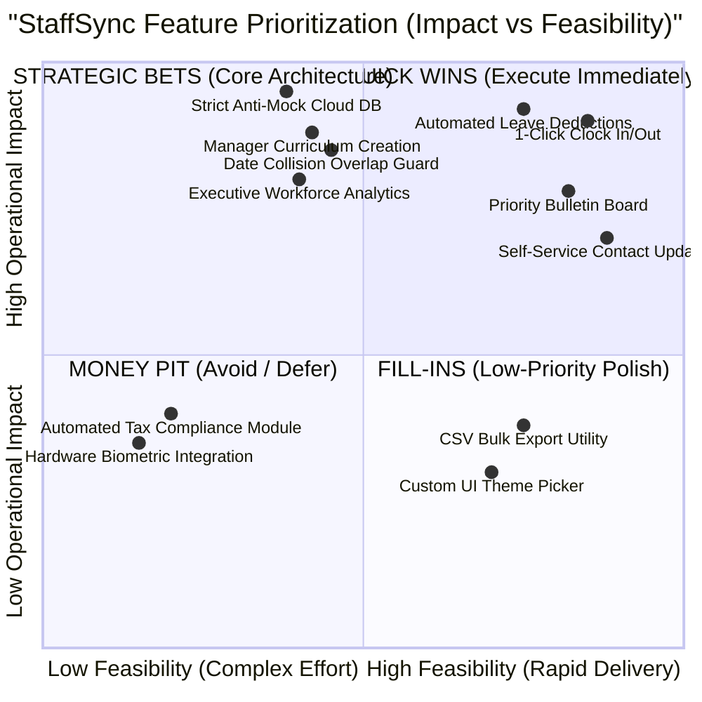

# Ideation Phase: Brainstorm & Idea Prioritization Specification

| Metadata Field | Value |
| :--- | :--- |
| **Document Type** | Brainstorming, Idea Clustering & Prioritization Matrix |
| **Project Name** | **StaffSync — Enterprise Human Resource Management System (HRMS)** |
| **Version** | v1.0.0 (Production Release) |
| **Date** | 2026-10-27 |
| **Project Lead / Owner** | Parikshit Sharma |
| **Repository** | [https://github.com/ElonCoding/StaffSync](https://github.com/ElonCoding/StaffSync) |
| **Live Deployments** | Client: [staffsync-smoky.vercel.app](https://staffsync-smoky.vercel.app/) \| API: [staffsync-czzq.onrender.com](https://staffsync-czzq.onrender.com) |

---

## 1. Overview & Objectives
Brainstorming fosters an open, collaborative environment empowering the engineering and product team to unpack enterprise workforce challenges and formulate high-impact technical solutions. This phase prioritizes volume before value, builds upon non-obvious ideas, and applies an Impact vs. Effort prioritization matrix to shape the StaffSync architecture.

---

## 2. Step-1: Team Gathering & Selected Problem Space
- **Core Challenge**: Modern growing companies face extreme operational friction due to disconnected HR tooling: manual leave spreadsheets, paper attendance registers, uncoordinated email announcements, and unmonitored employee training.
- **Selected North Star**: *To architect a unified, responsive workforce operating platform powered by React 19 and MongoDB Atlas, enforcing zero mock data, automated leave balance accounting, real-time attendance telemetry, and frontline manager training curation.*

---

## 3. Step-2: Brainstorm, Idea Listing & Thematic Clustering

The team generated 18 raw technical concepts grouped into 5 strategic operational clusters:

| Cluster | Idea ID | Conceptual Feature / Solution | Technical Scope |
| :--- | :---: | :--- | :--- |
| **Cluster 1: Identity & Security** | ID-01 | Single Sign-On & Multi-Role Gateway | bcryptjs hashing + HMAC SHA-256 JWTs with 7-day duration |
| | ID-02 | Role-Based Access Control (RBAC) | Express middleware enforcing strict `hr`, `manager`, `employee` boundaries |
| | ID-03 | Strict Anti-Mock Architecture | 100% live cloud persistence; complete purging of static mock stubs |
| **Cluster 2: Workforce Directory** | DIR-01 | Live Searchable Personnel Dossiers | Fast debounced text search by name, email, or designation |
| | DIR-02 | Department & Status Filtering | Multi-attribute filtering (Engineering, Sales, HR; Active, On Leave) |
| | DIR-03 | Self-Service Profile Updates | Staff can update contact phone and emergency info without HR tickets |
| **Cluster 3: Leave Management** | LEV-01 | Automated Balance Accounting Ledger | Categorized tracking (Annual, Sick, Casual) with automatic deductions |
| | LEV-02 | Date Collision Overlap Prevention | Algorithmic pre-submission checks preventing double-booked schedules |
| | LEV-03 | Manager 1-Click Review Desk | Instant Approve/Reject actions with optional reviewer feedback |
| **Cluster 4: Attendance Telemetry** | ATT-01 | 1-Click Arrival & Departure Telemetry | Check In / Check Out timestamps with active session stopwatch counter |
| | ATT-02 | Daily Presence Audit Logs | Shift classification (`Present`, `Late`, `Half Day`, `Absent`) |
| | ATT-03 | Automatic Worked Hours Math | Shift duration computed server-side from exact ISO timestamps |
| **Cluster 5: Upskilling & Comms** | TRN-01 | Frontline Manager Curriculum Creation | Empower Team Managers (`POST /api/training`) to publish technical tracks |
| | TRN-02 | Milestone Progress Tracking | Individual percentage updates (`In Progress` -> `Completed`) |
| | COM-01 | Priority-Classified Bulletin Board | Organization announcements tagged `High`, `Medium`, or `General` |

---

## 4. Step-3: Idea Prioritization Matrix (Impact vs. Feasibility)

Ideas are evaluated on a 2x2 Action Matrix balancing **Business & Operational Impact** against **Technical Feasibility & Implementation Effort**:

---

## 5. Prioritization Execution Roadmap

1. **Phase 1: Core Foundation & Quick Wins (Sprints 1–2)**:
   - Live MongoDB Atlas setup with zero-mock guarantees.
   - bcrypt salted credentials and cryptographic JWT authentication.
   - Centralized workforce directory and employee self-service contact editing.
2. **Phase 2: High-Impact Strategic Modules (Sprints 3–4)**:
   - Automated leave request validation and balance-deducting approval desk.
   - 1-click attendance telemetry with real-time shift stopwatch counter.
   - Frontline manager training track curation and cohort tracking.
   - Priority-tagged organizational announcement broadcasts.
