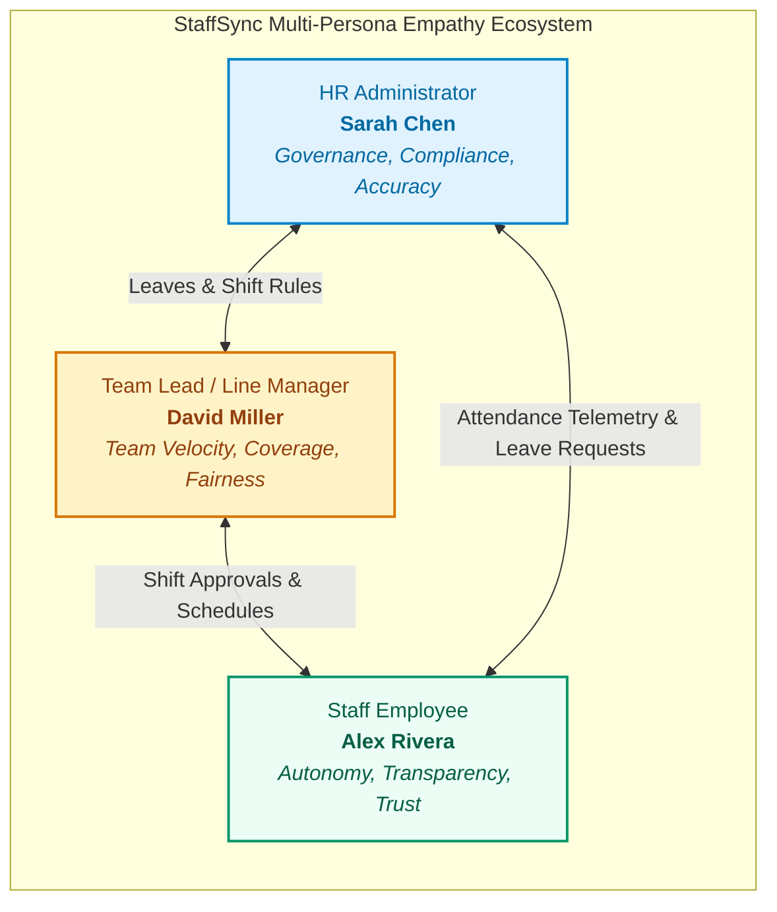
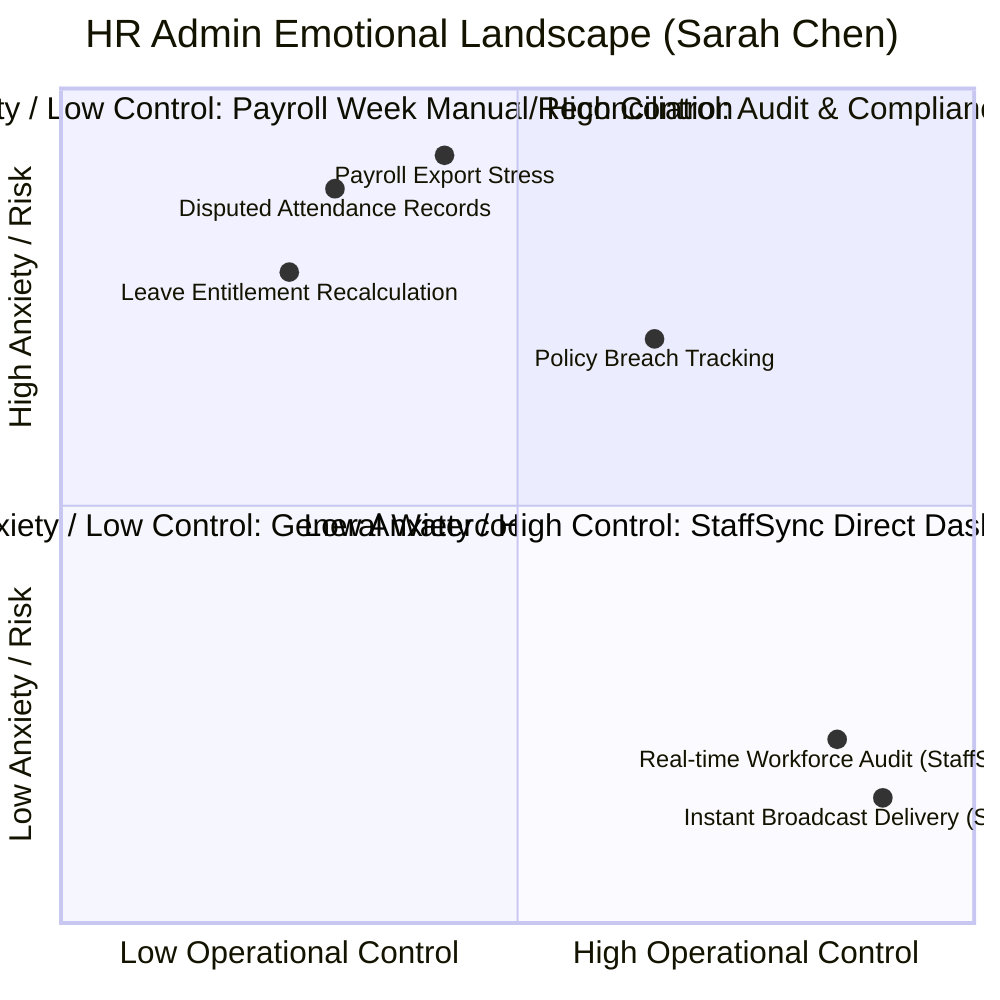
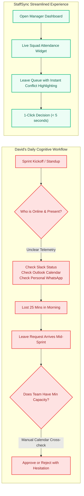
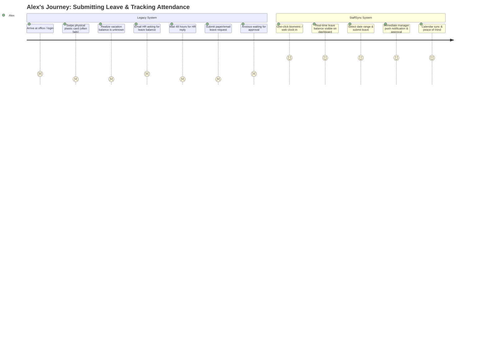
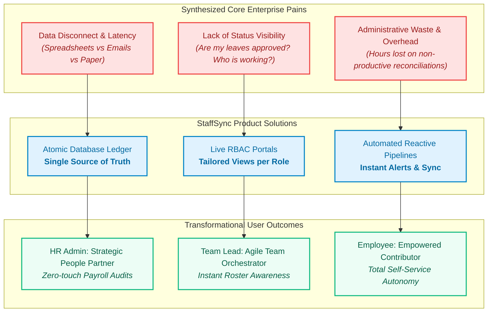

# StaffSync — Empathy Map Canvas
**Project Phase:** Ideation Phase (Phase 1)  
**System:** StaffSync — Enterprise Human Resource Management System (HRMS)  
**Version:** 1.0.0  
**Status:** Approved & Baselined  

---

## 1. Executive Overview & Methodology

The Empathy Map Canvas provides a structured framework for uncovering user needs, emotional frictions, cognitive loads, and unspoken motivations across the enterprise workplace. Rather than treating users as generic entities, StaffSync isolates three foundational enterprise personas:

1. **HR Administrator (Operational Controller)**: Responsible for regulatory compliance, records integrity, attendance governance, and company-wide broadcasts.
2. **Team Lead / Line Manager (Team Facilitator)**: Responsible for team availability, shift coverage, leave approvals, and daily operational delivery.
3. **Staff Employee (Individual Contributor)**: Focused on personal schedule visibility, transparent leave tracking, friction-free clock-in/out, and company updates.

---

## 2. Persona 1: HR Administrator (Sarah Chen)

### 2.1 Profile Summary
- **Demographics:** 34 years old, Senior HR Operations Specialist.
- **Context:** Oversees 350+ employees across 2 branch offices and remote engineering cohorts.
- **Primary Tooling Prior to StaffSync:** Microsoft Excel 2016, Outlook email chains, physical bulletin boards, legacy fingerprint biometric scanners with serial COM cables.

### 2.2 Quadrant Breakdown

| Canvas Quadrant | Deep Anthropological Observation & Evidence |
| :--- | :--- |
| **Who are we empathizing with?** | Sarah Chen, sole administrator handling onboarding, biometrics, leave reconciliation, and monthly payroll exports for 350+ employees under strict statutory labor deadlines. |
| **What do they need to DO?** | 1. Audit attendance logs daily without querying SQL databases or parsing broken CSV files. 2. Reconcile leave balances accurately according to employment seniority. 3. Dispatch company-wide announcements instantly with guaranteed delivery. 4. Generate audit-ready payroll and compliance reports with zero calculation discrepancies. |
| **What do they SEE?** | • Morning inbox inundated with 40+ emails marked "URGENT: Forgot to punch out". • Disparate Excel spreadsheets titled `Attendance_Final_v3_revised_Sarah.xlsx`. • Managers approving overlapping vacation requests, leaving mission-critical squads unstaffed. • Unread announcements pinned on physical breakroom corkboards ignored by staff. |
| **What do they SAY?** | • *"I spend three full days every month manually sanity-checking timestamps instead of developing people."* • *"If someone tampers with the spreadsheet formula, our entire payroll export corrupts."* • *"Half the company claims they never saw the revised work-from-home policy update."* |
| **What do they DO?** | • Manually inputs missing punch-in timestamps based on verbal trust or Slack chat logs. • Copies and pastes rows between disparate CSV files late on the 28th of every month. • Sends frantic reminder emails to team leads to approve pending leave queues. |
| **What do they HEAR?** | • **From CFO:** *"Why did overtime payroll increase 14% this month without pre-approval documentation?"* • **From Staff:** *"Why has my sick leave balance not updated? I took one day two weeks ago!"* • **From Auditors:** *"Produce timestamped proof of employee acknowledgment for safety compliance."* |
| **THINK & FEEL — PAINS** | • **Fear of Regulatory Penalty:** Inaccurate timesheets leading to labor law audit fines. • **Cognitive Overload:** Constant context switching between support tickets, Excel sheets, and email. • **Impostor Syndrome:** Feeling like an underappreciated data-entry clerk rather than a strategic HR leader. |
| **THINK & FEEL — GAINS** | • **Singular Source of Truth:** Centralized database where every punch, leave request, and department status is synchronized. • **Automated Balance Tracking:** Zero-touch leave ledger calculations. • **Peace of Mind:** One-click payroll export validated by cryptographic access controls. |

---

## 3. Persona 2: Team Lead / Line Manager (David Miller)

### 3.1 Profile Summary
- **Demographics:** 41 years old, Engineering Project Manager.
- **Context:** Leads 14 engineers and QA specialists across sprint cycles.
- **Primary Tooling Prior to StaffSync:** Jira, Slack, Outlook calendar, fragmented email vacation notices.

### 3.2 Quadrant Breakdown

| Canvas Quadrant | Deep Anthropological Observation & Evidence |
| :--- | :--- |
| **Who are we empathizing with?** | David Miller, technical lead responsible for sprint delivery deadlines, team morale, and resource allocation across overlapping project timelines. |
| **What do they need to DO?** | 1. Instantly ascertain daily team availability before standups. 2. Evaluate leave requests against project milestones without opening separate calendars. 3. Approve or reject team leave requests fairly and transparently. 4. Monitor team attendance trends without acting like a micro-managing overseer. |
| **What do they SEE?** | • Slack status messages stating "AFK doctor appointment" with no formal HR record. • Two senior developers requesting the identical Christmas release week off simultaneously. • Conflicting calendars where Outlook says "Available" but the employee is on approved leave. |
| **What do they SAY?** | • *"I just want to know who is working today so I can allocate sprint tickets effectively."* • *"It's awkward rejecting a junior engineer's leave request because I can't easily show them who else is already off."* • *"HR emails me asking to approve a leave that happened two weeks ago."* |
| **What do they DO?** | • Maintains a shadow Excel schedule on personal Google Drive to avoid project collisions. • Sends morning Slack pings: *"Hey folks, who is in office today vs remote?"* • Delays approving formal leave requests because checking historical balance takes too long. |
| **What do they HEAR?** | • **From VP Engineering:** *"Why did the production release slip? Did we not anticipate the frontend lead's vacation?"* • **From Direct Reports:** *"David, did you see my leave request email from last Thursday? I need to book flight tickets today!"* |
| **THINK & FEEL — PAINS** | • **Blame Attribution:** Taking the heat for missed project delivery due to uncoordinated leaves. • **Managerial Friction:** Appearing authoritarian when asking staff why they haven't punched in. • **Administrative Burden:** Wasting 4 hours per week acting as an administrative intermediary between staff and HR. |
| **THINK & FEEL — GAINS** | • **Team Heatmap:** A visual roster dashboard revealing squad coverage in real time. • **Collision Alerts:** Automatic system warnings when two members in identical roles request simultaneous leave. • **Instant Mobile Action:** Approve requests with one tap from phone or desktop notification. |

---

## 4. Persona 3: Staff Employee / Individual Contributor (Alex Rivera)

### 4.1 Profile Summary
- **Demographics:** 26 years old, Mid-Level UI/UX Designer.
- **Context:** Hybrid worker (3 days in-office, 2 days remote), values autonomy, work-life balance, and clear communication.
- **Primary Tooling Prior to StaffSync:** Browser webmail, paper forms, plastic RFID badges that get lost or forgotten.

### 4.2 Quadrant Breakdown

| Canvas Quadrant | Deep Anthropological Observation & Evidence |
| :--- | :--- |
| **Who are we empathizing with?** | Alex Rivera, salaried staff member striving to excel at design deliverables while managing personal well-being, PTO planning, and daily attendance logs. |
| **What do they need to DO?** | 1. Clock in and out seamlessly on arrival with immediate confirmation. 2. Check exact available Paid Time Off (PTO), Sick, and Casual leave balances on demand. 3. Request leaves in under 30 seconds with immediate visibility into status. 4. Stay informed about company holidays, town halls, and operational updates without reading lengthy email spam. |
| **What do they SEE?** | • Broken biometric wall scanners with red blinking error lights. • Vague leave records where "pending" leaves stay unanswered for days. • Generic all-hands company emails cluttering inbox while critical announcements get buried. |
| **What do they SAY?** | • *"Why can't I just clock in from my laptop dashboard when I'm working from home?"* • *"I have no idea how many vacation days I have left without emailing HR and waiting days."* • *"I booked flights for holiday because nobody rejected my request, but it wasn't approved either."* |
| **What do they DO?** | • Forgets physical access card at home and has to plead with building security. • Keeps personal tally of sick days in phone notes app. • Skims past important company news updates because newsletters look unformatted and dry. |
| **What do they HEAR?** | • **From HR:** *"Your punch-out log was missing on Tuesday, so the system marked you as half-day absent."* • **From Colleagues:** *"Don't bother using the old web portal, it crashes whenever you upload a medical cert."* |
| **THINK & FEEL — PAINS** | • **Anxiety Over Unfair Penalties:** Stress that unrecorded clock-outs will result in salary deductions. • **Lack of Agency:** Feeling powerless having to ask permission just to view basic personal records. • **Disconnection:** Missing important company cultural moments or policy announcements. |
| **THINK & FEEL — GAINS** | • **Radical Transparency:** Self-service portal where leave balances, attendance streaks, and history are visible 24/7. • **Frictionless Routine:** Clocking in takes 1 second directly from user workstation. • **Dignified Communication:** Clear, dignified UI that respects employee time and intelligence. |

---

## 5. Cross-Persona Empathy Synthesis & System Opportunities

---

## 6. Actionable UX Design Directives for StaffSync

Based on empathy mapping findings, the StaffSync application interface and architecture adhere to these non-negotiable UX principles:

1. **Rule of Single-Tap Telemetry**: Clock-in and clock-out actions must be prominent, immediate, and accompanied by micro-animations confirming success, location stamp, and server synchronization time.
2. **Zero-Mental-Math Leave Ledger**: The employee leave widget must clearly show `[Total Entitled] - [Used] - [Pending] = [Current Available Balance]` with zero cognitive ambiguity.
3. **Manager Contextual Collision Detection**: When a team lead views a pending leave request, the modal interface must dynamically render concurrent team member absences for that exact calendar window.
4. **Rich Pinned Announcements**: Administrative announcements must support priority tags (`Urgent`, `Policy`, `Celebration`, `General`) and display read-receipt telemetry to administrators.
5. **Universal Role-Based Access Control (RBAC)**: Interface clutter is eliminated by rendering strictly the controls relevant to the authenticated persona.

---
*StaffSync Documentation Suite • Ideation Phase (Phase 1) • Baselined for Engineering Implementation*
