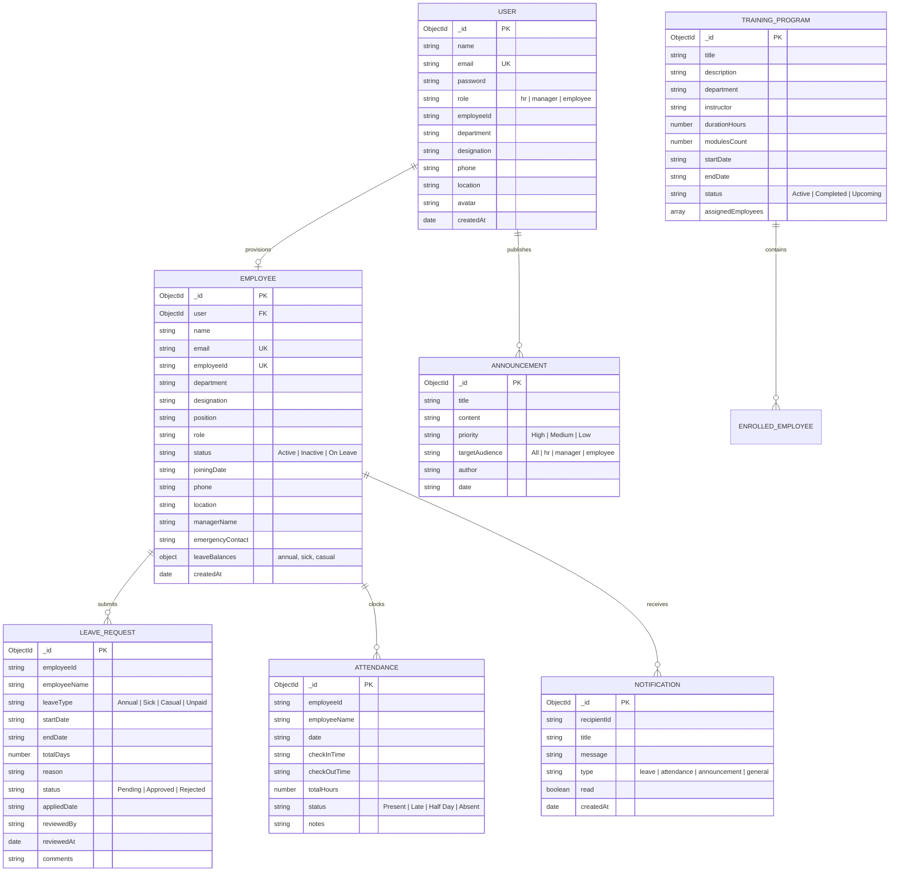

# Phase 4: Project Design Phase — Database Schema & ER Diagram

## 1. Entity-Relationship Diagram (ERD)

---

## 2. Indexing Strategy for High Throughput
- `User.email`: Unique index for instant lookups during authentication.
- `Employee.employeeId`: Unique index ensuring no duplicate workforce IDs across departments.
- `Employee.user`: Foreign key index linking credentials to employee profiles.
- `Attendance.employeeId` + `Attendance.date`: Compound index ensuring single-query resolution of daily attendance and fast date-range filtering.
- `LeaveRequest.employeeId`: Indexed for rapid history rendering on self-service portals.
