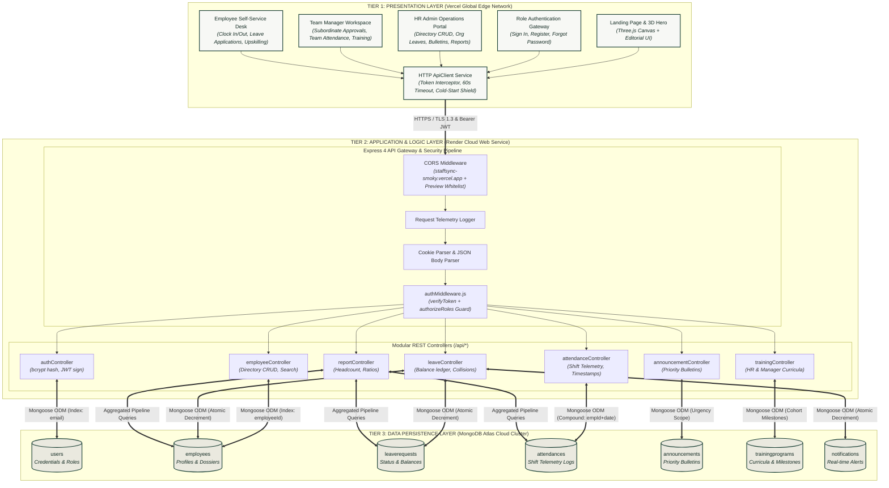
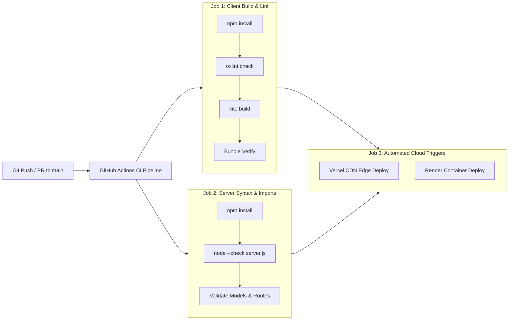

# Project Design Phase: Solution Architecture Specification

| Metadata Field | Value |
| :--- | :--- |
| **Document Type** | Technical Solution Architecture & Systems Engineering Specification |
| **Project Name** | **StaffSync — Enterprise Human Resource Management System (HRMS)** |
| **Version** | v1.0.0 (Production Release) |
| **Date** | 2026-10-27 |
| **Project Lead / Owner** | Parikshit Sharma |
| **Repository** | [https://github.com/ElonCoding/StaffSync](https://github.com/ElonCoding/StaffSync) |
| **Live Deployments** | Client: [staffsync-smoky.vercel.app](https://staffsync-smoky.vercel.app/) \| API: [staffsync-czzq.onrender.com](https://staffsync-czzq.onrender.com) |

---

## 1. Architectural Strategy & Design Principles
The **StaffSync** architecture is engineered to provide enterprise-grade reliability, sub-second interactive responsiveness, and uncompromising cryptographic security across all workforce administrative domains.

### Core Architectural Capabilities:
- **Decoupled 3-Tier Enterprise Topology**: Presentation, Business Logic, and Persistence layers operate independently with stateless REST contracts.
- **Strict Role-Based Access Control (RBAC)**: Cryptographically verified JWT bearer tokens govern operational permissions for `hr`, `manager`, and `employee` roles.
- **Zero-Mock Policy & Live Telemetry**: All data queries and state mutations run directly against cloud MongoDB Atlas collections with Mongoose schema constraints.
- **Cold-Start Resilience**: 60-second client-side timeout calibration accommodating cloud container wakeups without raising browser network exceptions.
- **Edge Content Delivery**: Global distribution of optimized single-page application (SPA) bundles via Vercel Global Edge Network with universal rewrite rules.

---

## 2. Solution Architecture Diagram

---

## 3. Tier-by-Tier Architectural Breakdown

### 3.1 Presentation Tier (Frontend Client)
- **Technology Stack**: React 19, TypeScript, Vite 8, Tailwind CSS v4, Three.js, Lucide React.
- **Routing & Navigation**: React Router v7 with protected route wrappers (`RequireAuth`, `RequireRole`).
- **State & Networking**: Centralized `ApiClient.js` handles authorization token injection, request cancellation via `AbortController`, and intelligent environment resolution (auto-pointing to Render in production).
- **Hosting**: Vercel Global Edge Network with `client/vercel.json` SPA rewrite rules.

### 3.2 Application Logic Tier (Backend REST Service)
- **Technology Stack**: Node.js 20+, Express 4 (ES Modules), Mongoose 8.
- **Security Pipeline**:
  - `cors`: Dynamic origin validation ensuring only verified client origins communicate with the API.
  - `bcryptjs`: One-way cryptographic password salting and hashing with cost factor 10.
  - `jsonwebtoken`: Stateless HMAC SHA-256 JWT generation with role and department claims.
  - `authMiddleware`: Enforces token validity, checks expiration, and evaluates role permissions.
- **Hosting**: Render Cloud Web Service with automated continuous deployment and health checks at `/api/health`.

### 3.3 Data Persistence Tier (Cloud Database)
- **Technology Stack**: MongoDB Atlas managed cloud cluster.
- **Data Modeling & Integrity**:
  - `users`: Stores core credentials, hashed passwords, and system roles.
  - `employees`: Stores comprehensive HR dossiers, job titles, and balance arrays (`annual`, `sick`, `casual`).
  - `leaverequests`: Enforces date range collision detection and status state machines (`Pending`, `Approved`, `Rejected`).
  - `attendances`: Records exact check-in/out timestamps and computes worked shift hours.
  - `trainingprograms`: Stores curricula, module counts, and enrolled employee cohort milestones.
  - `announcements`: Stores priority-tagged organizational bulletins.

---

## 4. Continuous Integration & Deployment Pipeline

