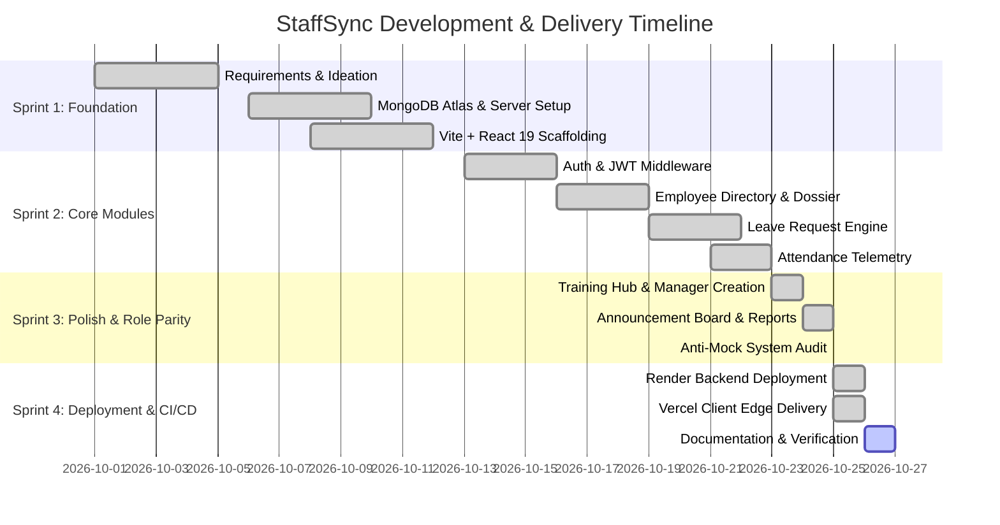

# Phase 2: Project Planning Phase — Resource Allocation & Sprint Schedule

## 1. Technological & Tooling Resources

| Component | Selected Technology | Version | Justification |
| :--- | :--- | :--- | :--- |
| **Frontend Framework** | React + TypeScript | 19.x | Component lifecycle hooks, strict typing, high render efficiency |
| **Bundler & Build Tool**| Vite | 8.x | Near-instant HMR, optimized production tree-shaking |
| **Styling Engine** | Tailwind CSS | 4.x | Utility-first CSS, custom design tokens, rapid responsive layout |
| **Backend Runtime** | Node.js (ESM) | 20+ / 22+ | Event-driven architecture, native ES Modules support |
| **Web Server** | Express | 4.x | Robust middleware ecosystem, RESTful routing simplicity |
| **Database & ODM** | MongoDB Atlas / Mongoose | 8.x | High-availability cloud clustering, schema flexibility, document indexing |
| **Security & Crypto** | jsonwebtoken + bcryptjs | Standard | Stateless token claims, salted password encryption |
| **3D Engine** | Three.js | Standard | Interactive landing page geometry |
| **Hosting Platform** | Vercel (Client) + Render (API) | Cloud | Global CDN edge delivery coupled with containerized Node service |

---

## 2. Iterative Sprint Schedule

