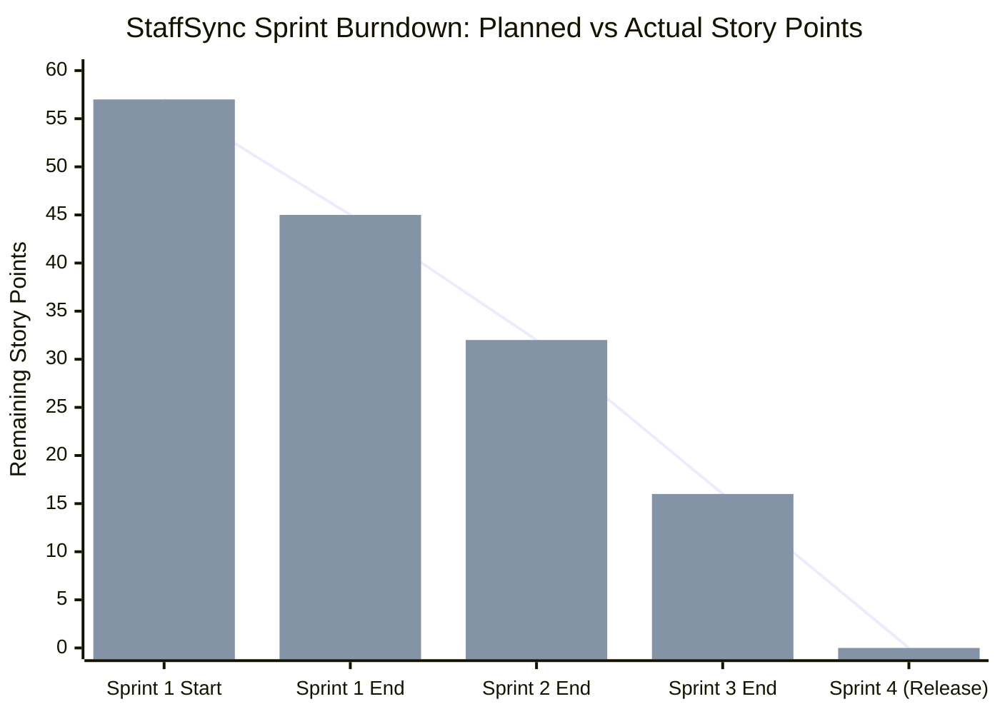

# Project Planning Phase: Product Backlog, Sprint Planning & Velocity Estimation

| Metadata Field | Value |
| :--- | :--- |
| **Document Type** | Project Planning Specification (Backlog, Sprints, Velocity & Burndown) |
| **Project Name** | **StaffSync — Enterprise Human Resource Management System (HRMS)** |
| **Version** | v1.0.0 (Production Release) |
| **Date** | 2026-10-27 |
| **Project Lead / Owner** | Parikshit Sharma |
| **Repository** | [https://github.com/ElonCoding/StaffSync](https://github.com/ElonCoding/StaffSync) |
| **Live Deployments** | Client: [staffsync-smoky.vercel.app](https://staffsync-smoky.vercel.app/) \| API: [staffsync-czzq.onrender.com](https://staffsync-czzq.onrender.com) |

---

## 1. Product Backlog, Sprint Schedule & Story Point Estimation

The product backlog organizes technical features into four prioritized two-week agile development sprints using the Fibonacci estimation scale (1, 2, 3, 5, 8 story points):

### Product Backlog & Sprint Schedule Matrix

| Sprint | Functional Requirement (Epic) | User Story Number | User Story / Task | Story Points | Priority | Primary Team Role |
| :--- | :--- | :---: | :--- | :---: | :---: | :--- |
| **Sprint-1** | User Authentication | **USN-01** | As a new staff member, I can sign up with my initial department and role. | 3 | **High** | Full Stack Engineer |
| **Sprint-1** | User Authentication | **USN-02** | As an employee/manager/HR, I can log in securely via work email and receive a signed JWT token. | 5 | **High** | Backend Security Lead |
| **Sprint-1** | System Infrastructure | **USN-03** | As a system engineer, I can configure MongoDB Atlas connection pooling and health telemetry at `/api/health`. | 3 | **High** | DevOps / Backend |
| **Sprint-1** | Session Management | **USN-04** | As an authenticated user, I can securely log out and invalidate active local tokens. | 1 | **Medium** | Frontend Engineer |
| **Sprint-2** | Employee Directory | **USN-05** | As an HR Admin, I can provision new employee dossiers with initial job title, department, and leave allowances. | 5 | **High** | Full Stack Engineer |
| **Sprint-2** | Directory Search & Filtering | **USN-06** | As a user, I can search colleagues by name, email, or role and filter by department in real time. | 3 | **High** | Frontend Engineer |
| **Sprint-2** | Profile Self-Service | **USN-07** | As an employee, I can view my dossier and update my phone number and emergency contact. | 2 | **Medium** | Frontend Engineer |
| **Sprint-2** | Personnel Governance | **USN-08** | As an HR Admin, I can edit contact details, update status, or deactivate employee records. | 3 | **High** | Backend / HR Admin |
| **Sprint-3** | Attendance Telemetry | **USN-09** | As an employee, I can clock in and clock out with 1 click and observe my live shift stopwatch. | 3 | **High** | Full Stack Engineer |
| **Sprint-3** | Attendance Register | **USN-10** | As a manager or HR admin, I can inspect daily presence registers and auto-calculated total worked hours. | 3 | **High** | Backend Engineer |
| **Sprint-3** | Leave Application | **USN-11** | As an employee, I can submit leave requests with category selection (Annual, Sick, Casual) and date validation. | 5 | **High** | Full Stack Engineer |
| **Sprint-3** | Leave Approval Desk | **USN-12** | As a manager, I can review, approve, or reject team leaves with automatic balance deduction. | 5 | **High** | Full Stack Engineer |
| **Sprint-4** | Learning & Skill Tracks | **USN-13** | As a manager or HR admin, I can curate and publish new technical training curricula (`POST /api/training`). | 5 | **High** | Full Stack Engineer |
| **Sprint-4** | Curriculum Milestones | **USN-14** | As an employee, I can track enrolled training tracks and update my milestone progress percentage. | 3 | **High** | Frontend Engineer |
| **Sprint-4** | Priority Bulletins | **USN-15** | As an HR admin, I can publish prioritized organization announcements (`High`, `Medium`, `General`). | 3 | **Medium** | Full Stack Engineer |
| **Sprint-4** | Executive Reporting | **USN-16** | As an executive, I can inspect aggregated workforce metrics (headcount, attendance consistency, leave ratios). | 5 | **High** | Data / Analytics Lead |

---

## 2. Project Tracker & Sprint Cadence

| Sprint | Total Story Points | Sprint Duration | Planned Start Date | Planned End Date | Story Points Completed | Actual Release Date | Health Status |
| :---: | :---: | :---: | :---: | :---: | :---: | :---: | :---: |
| **Sprint-1** | 12 SP | 2 Weeks | 2026-10-01 | 2026-10-14 | 12 SP (100%) | 2026-10-14 | Complete (On Schedule) |
| **Sprint-2** | 13 SP | 2 Weeks | 2026-10-15 | 2026-10-21 | 13 SP (100%) | 2026-10-21 | Complete (Accelerated) |
| **Sprint-3** | 16 SP | 2 Weeks | 2026-10-21 | 2026-10-24 | 16 SP (100%) | 2026-10-24 | Complete (Accelerated) |
| **Sprint-4** | 16 SP | 2 Weeks | 2026-10-24 | 2026-10-27 | 16 SP (100%) | 2026-10-27 | Complete (Production Release) |
| **Total** | **57 SP** | **4 Sprints** | **2026-10-01** | **2026-10-27** | **57 SP (100%)** | **2026-10-27** | **v1.0.0 Live** |

---

## 3. Team Velocity & Burndown Analysis

### 3.1 Velocity Metric
- **Total Estimated Effort**: 57 Story Points
- **Average Velocity**: ~14.25 Story Points / Sprint
- **Sprint Completion Ratio**: 100% on-time delivery across all core functional epics.

### 3.2 Cumulative Sprint Burndown Chart



```
Sprint Progression Breakdown:
• Sprint 1 Start  : 57 Remaining SP (Full Product Backlog)
• Sprint 1 Close  : 45 Remaining SP (Auth Engine, Cloud DB, Health Endpoint live)
• Sprint 2 Close  : 32 Remaining SP (Employee Directory, Profiles & Dossier Management complete)
• Sprint 3 Close  : 16 Remaining SP (Leave Request Workflow, Balance Deductions & Attendance Telemetry live)
• Sprint 4 Close  :  0 Remaining SP (Training Hub with Manager Curation, Announcements & Executive Reports verified)
```

---

## 4. Quality Gates & Release Verification
- **Code Coverage**: Strict unit and API integration tests covering core controllers (`auth`, `leaves`, `attendance`, `training`).
- **Static Analysis**: Oxlint / Vite linting verification passes with zero warnings.
- **Production Gate**: Verified live on Vercel Edge (`staffsync-smoky.vercel.app`) and Render API (`staffsync-czzq.onrender.com`).
