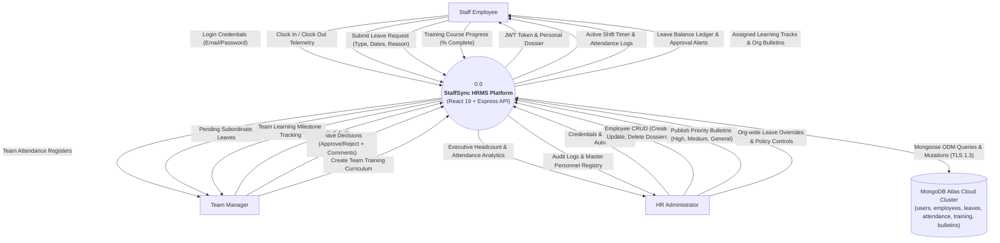
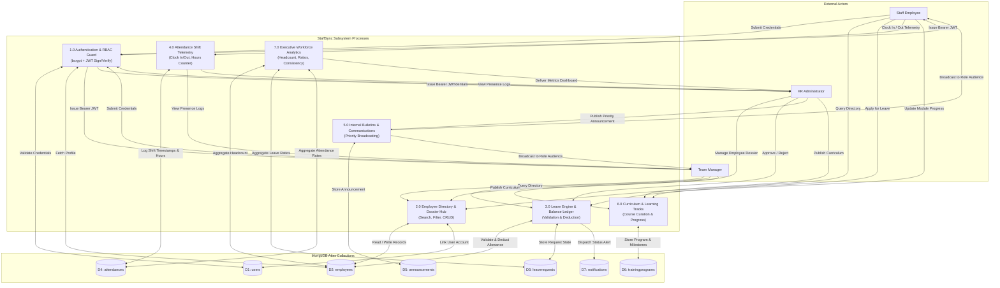
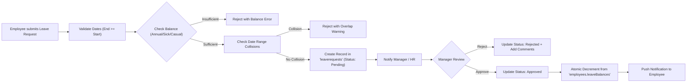

# Project Design Phase-II: Data Flow Diagram & User Stories

| Metadata Field | Value |
| :--- | :--- |
| **Document Type** | Data Flow Diagram (DFD) & User Stories Specification |
| **Project Name** | **StaffSync — Enterprise Human Resource Management System (HRMS)** |
| **Version** | v1.0.0 (Production Release) |
| **Date** | 2026-10-27 |
| **Project Lead / Owner** | Parikshit Sharma |
| **Repository** | [https://github.com/ElonCoding/StaffSync](https://github.com/ElonCoding/StaffSync) |
| **Live Deployments** | Client: [staffsync-smoky.vercel.app](https://staffsync-smoky.vercel.app/) \| API: [staffsync-czzq.onrender.com](https://staffsync-czzq.onrender.com) |

---

## 1. Introduction to Data Flow Diagrams (DFD)
A **Data Flow Diagram (DFD)** maps the flow of information through the StaffSync platform. It captures external entities (Staff Employees, Team Managers, HR Administrators), core transactional business processes, data transformations, and underlying persistent cloud data stores (MongoDB Atlas collections).

---

## 2. DFD Level 0: Context Level Diagram (Industry Standard)

The Level 0 DFD provides a high-level view of the entire StaffSync HRMS boundary and interactions with authorized external organizational actors:

---

## 3. DFD Level 1: Subsystem Data Flow Diagram

The Level 1 DFD decomposes StaffSync into its 7 core operational subsystems and explicit data stores:

---

## 4. DFD Level 2: Detailed Leave Approval Lifecycle Flow

---

## 5. User Stories & Acceptance Criteria Matrix

| User Type | Functional Requirement (Epic) | User Story / Task | Acceptance Criteria | Priority | Release |
| :--- | :--- | :--- | :--- | :---: | :---: |
| **All Users** | User Authentication | As a user, I can log in using my work email and password. | Returns signed JWT token; redirects to role dashboard (`/hr`, `/manager`, `/employee`). | **High** | **Sprint-1** |
| **All Users** | User Registration | As a new employee, I can register an account with my initial department and role. | Creates user record in `users` collection and provisions matching `employees` dossier. | **High** | **Sprint-1** |
| **Staff Member** | Attendance Telemetry | As an employee, I can clock in and out with a single click. | Logs timestamp, activates real-time session counter, and computes total shift hours upon clock-out. | **High** | **Sprint-1** |
| **Staff Member** | Leave Application | As an employee, I can submit leave requests and check my balance in real-time. | Validates leave allowance before submitting; displays status as `Pending`. | **High** | **Sprint-1** |
| **Team Manager** | Leave Approval Desk | As a manager, I can review, approve, or reject subordinate leave requests. | Status updates immediately; approved leaves automatically deduct days from employee balance. | **High** | **Sprint-2** |
| **Team Manager** | Team Skill Upgrading | As a manager, I can curate and publish technical training tracks for my team. | Modal validates curriculum fields (`POST /api/training`); curriculum card appears in team track grid. | **High** | **Sprint-2** |
| **HR Admin** | Workforce Directory | As an HR Admin, I can add, edit, and delete employee dossiers. | Changes persist directly to MongoDB Atlas; directory reloads dynamically without mock data. | **High** | **Sprint-1** |
| **HR Admin** | Organizational Bulletins | As an HR Admin, I can publish prioritized bulletins (`High`, `Medium`, `General`). | Bulletins display with priority color badges and are targeted to selected user roles. | **Medium** | **Sprint-2** |
| **All Users** | Directory Filtering | As a user, I can search and filter colleagues by department and active status. | Search bar instantly filters cards with zero full page reloads. | **Medium** | **Sprint-2** |
| **HR Admin** | Executive Analytics | As an executive, I can monitor org-wide attendance rates, headcount, and leave trends. | Metric cards render real-time calculations from live database collections. | **Medium** | **Sprint-2** |
